# BraunX4-4-Bit-Array-Multiplier(Braun-Multiplier)
BraunX4 is a 4-bit unsigned Braun Array Multiplier designed for efficient binary computation.It combines parallel partial-product generation using AND gates with optimized Half Adder and Full Adder stages to produce a precise 8-bit output, demonstrating combinational logic, modular architecture, and core VLSI design principles for modern systems!

  
  
  
  

---

## Table of Contents

1. [Project Highlights & Key Specifications](#project-highlights--key-specifications)
2. [Tools and Technologies Used](#tools-and-technologies-used)
3. [Fundamental Logic Gate Design & Simulation](#fundamental-logic-gate-design--simulation)
   - 3.1 NOT Gate (Inverter)
   - 3.2 OR Gate
   - 3.3 NAND Gate
   - 3.4 XOR Gate 
4. [Arithmetic Circuit Design](#arithmetic-circuit-design)
   - 4.1 Half Adder Design
   - 4.2 Full Adder Design
5. [BraunX4 Multiplier Architecture](#braunx4-multiplier-architecture)
   - 5.1 Partial Product Generation
   - 5.2 Adder Array Configuration
   - 5.3 4-Bit Binary Multiplication
6. [Circuit Implementation & Schematic Design](#circuit-implementation--schematic-design)
7. [Simulation Results & Waveform Analysis](#simulation-results--waveform-analysis)
   - 7.1 Half Adder Simulation
   - 7.2 Full Adder Simulation
   - 7.3 BraunX4 Multiplier Simulation
   - 7.4 Functional Verification
9. [Applications](#applications)
10. [Future Enhancements](#future-enhancements)
11. [Conclusion](#conclusion)
12. [Acknowledgements](#acknowledgements)

---

## Project Highlights & Key Specifications

| Parameter | Specification / Value |
|:---|:---|
| Project Name | BraunX4 – 4-Bit Array Multiplier |
| Multiplier Architecture | Braun Array Multiplier |
| Multiplication Type | Unsigned Binary Multiplication |
| Input A Width | 4 Bits |
| Input B Width | 4 Bits |
| Output Product Width | 8 Bits |
| Partial Product Generation | 16 Partial Products |
| Partial Product Circuit | AND Gate Logic |
| Arithmetic Components | Half Adders (HA) & Full Adders (FA) |
| Logic Design | Combinational Logic Architecture |
| Design Methodology | Schematic-Based Circuit Design |
| EDA Tool | Cadence Virtuoso |
| Circuit Modules | Inverter, NAND, OR, XOR, Half Adder, Full Adder |
| Main Circuit | 4-Bit Braun Array Multiplier |
| Simulation | Transient Waveform Analysis |
| Verification | Functional Simulation |
| Design Objective | Accurate and Efficient Binary Multiplication |
| Applications | ALUs, DSP Systems, Microprocessors & Embedded Systems |

---

## Tools & Technologies Used

| Category | Tool / Technology |
|:---|:---|
| EDA Platform | Cadence Virtuoso |
| Schematic Design | Cadence Virtuoso Schematic Editor |
| Simulation Environment | Cadence Virtuoso ADE |
| Waveform Analysis | Cadence Visualization & Analysis XL |
| Circuit Simulator | Spectre |
| Design Methodology | Schematic-Based Circuit Design |
| Circuit Architecture | Combinational Logic |
| Logic Components | AND, NAND, OR, XOR, NOT Gates |
| Arithmetic Components | Half Adders & Full Adders |
| Multiplier Architecture | 4-Bit Braun Array Multiplier |
| Simulation Analysis | Transient Analysis |
| Operating Environment | Linux |
| Design Domain | Digital VLSI Design |
| Verification Method | Functional Simulation & Waveform Analysis |

---

---

## 3. Fundamental Logic Gate Design & Simulation

Fundamental logic gates are the essential building blocks of digital electronic systems. As part of the BraunX4 project, basic CMOS logic gate design is explored using Cadence Virtuoso. These circuits establish the foundation for understanding transistor-level implementation, Boolean logic operations, and combinational circuit behavior. The schematic design and simulation provide insights into the operation of fundamental digital building blocks.

### 3.1 NOT Gate (Inverter)

The NOT Gate, also known as an inverter, is a fundamental CMOS logic circuit that performs logical inversion of its input signal. It consists of complementary NMOS and PMOS transistors, producing an output that is the logical opposite of the applied input.

**Boolean Expression:**

Y = A'

**Operating Principle:**
- When input A is LOW (0), output Y becomes HIGH (1).
- When input A is HIGH (1), output Y becomes LOW (0).
- The PMOS transistor acts as the pull-up network.
- The NMOS transistor acts as the pull-down network.

**Truth Table:**

| Input (A) | Output (Y) |
|:---:|:---:|
| 0 | 1 |
| 1 | 0 |

**Schematic Design – Cadence Virtuoso**

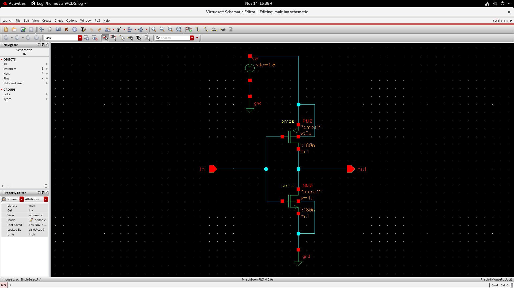

---

### 3.2 NAND Gate

The NAND gate is a universal logic gate that performs the complement of the AND operation. It produces a LOW output only when both inputs are HIGH. Its CMOS implementation uses a combination of PMOS and NMOS transistors to achieve the required switching behavior.

**Boolean Expression:**

`Y = (A · B)'`

**Operating Principle:**
- When both inputs are HIGH (1), output Y becomes LOW (0).
- For all other input combinations, output Y remains HIGH (1).
- PMOS transistors form the pull-up network.
- NMOS transistors form the pull-down network.

**Truth Table:**

| A | B | Y |
|:---:|:---:|:---:|
| 0 | 0 | 1 |
| 0 | 1 | 1 |
| 1 | 0 | 1 |
| 1 | 1 | 0 |

**Schematic Design – Cadence Virtuoso**

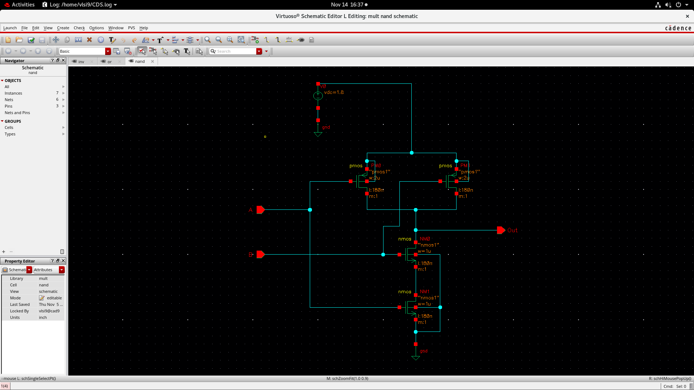

---

### 3.3 OR Gate

The OR gate is a fundamental combinational logic circuit that performs logical addition of two binary inputs. It generates a HIGH output whenever at least one input is HIGH. It is widely used in digital decision-making and control logic circuits.

**Boolean Expression:**

`Y = A + B`

**Operating Principle:**
- When both inputs are LOW, output Y becomes LOW.
- When either or both inputs are HIGH, output Y becomes HIGH.
- The circuit performs logical addition of binary inputs.

**Truth Table:**

| A | B | Y |
|:---:|:---:|:---:|
| 0 | 0 | 0 |
| 0 | 1 | 1 |
| 1 | 0 | 1 |
| 1 | 1 | 1 |

**Schematic Design – Cadence Virtuoso**

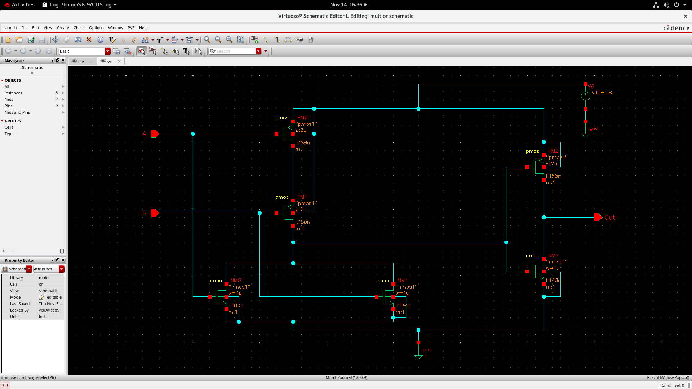

---

### 3.4 XOR Gate

The XOR (Exclusive-OR) gate is an essential digital logic circuit that produces a HIGH output when its two binary inputs are different. It plays a significant role in arithmetic operations, particularly in Sum generation within Half Adders and Full Adders.

**Boolean Expression:**

`Y = A ⊕ B`

**Operating Principle:**
- When both inputs are identical, output Y becomes LOW.
- When the inputs are different, output Y becomes HIGH.
- It is a fundamental component of binary addition circuits.

**Truth Table:**

| A | B | Y |
|:---:|:---:|:---:|
| 0 | 0 | 0 |
| 0 | 1 | 1 |
| 1 | 0 | 1 |
| 1 | 1 | 0 |

**Schematic Design – Cadence Virtuoso**

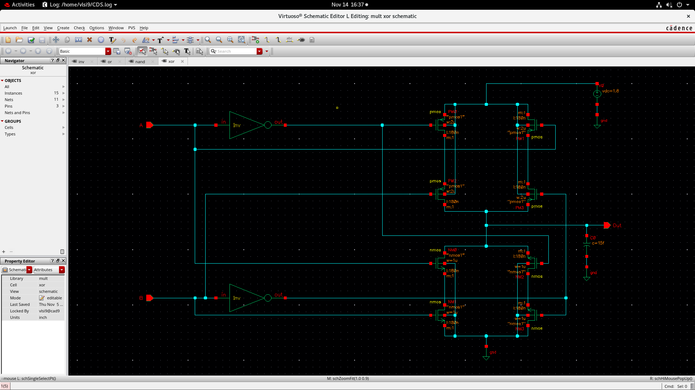

---

---

## 4. Arithmetic Circuit Design

Arithmetic circuits are fundamental components of digital computing architectures responsible for performing binary mathematical operations. In BraunX4, Half Adders and Full Adders form the core arithmetic building blocks used for partial product accumulation. Both circuits are designed using CMOS logic and implemented in Cadence Virtuoso to demonstrate efficient combinational arithmetic operations.

### 4.1 Half Adder Design

A Half Adder is a combinational arithmetic circuit that performs the addition of two single-bit binary inputs (A and B). It generates two outputs: Sum and Carry. The Sum output is obtained using an XOR operation, while the Carry output is generated using an AND operation.

**Boolean Expressions:**

- Sum = A ⊕ B
- Carry = A · B

**Truth Table:**

| A | B | Sum | Carry |
|:---:|:---:|:---:|:---:|
| 0 | 0 | 0 | 0 |
| 0 | 1 | 1 | 0 |
| 1 | 0 | 1 | 0 |
| 1 | 1 | 0 | 1 |

**Key Features:**
- Two binary inputs and two outputs.
- XOR-based Sum generation.
- AND-based Carry generation.
- Fundamental building block for binary arithmetic.

**Schematic Design – Cadence Virtuoso**

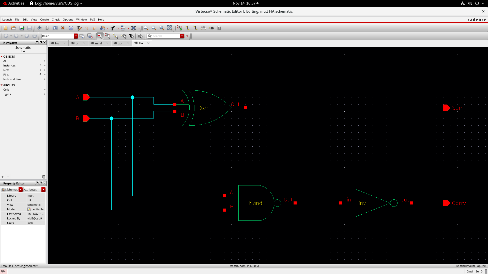

---

### 4.2 Full Adder Design

A Full Adder is a combinational arithmetic circuit that performs the addition of three single-bit binary inputs: A, B, and Carry-in (Cin). It generates two outputs, Sum and Carry-out (Cout), enabling multi-bit binary addition and carry propagation across successive arithmetic stages.

**Boolean Expressions:**

- Sum = A ⊕ B ⊕ Cin
- Cout = AB + ACin + BCin

**Truth Table:**

| A | B | Cin | Sum | Cout |
|:---:|:---:|:---:|:---:|:---:|
| 0 | 0 | 0 | 0 | 0 |
| 0 | 0 | 1 | 1 | 0 |
| 0 | 1 | 0 | 1 | 0 |
| 0 | 1 | 1 | 0 | 1 |
| 1 | 0 | 0 | 1 | 0 |
| 1 | 0 | 1 | 0 | 1 |
| 1 | 1 | 0 | 0 | 1 |
| 1 | 1 | 1 | 1 | 1 |

**Key Features:**
- Three binary inputs and two outputs.
- Supports carry-in and carry-out operations.
- XOR-based Sum generation.
- Enables multi-stage binary addition.
- Essential arithmetic component in multiplier architectures.

**Schematic Design – Cadence Virtuoso**

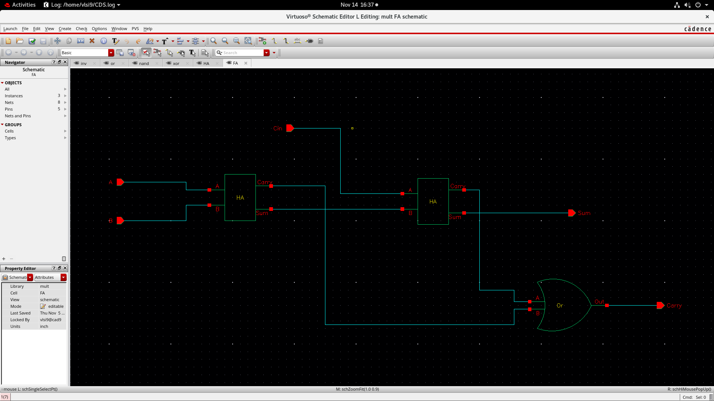

---

---

## 5. BraunX4 Multiplier Architecture

The BraunX4 multiplier is a 4-bit unsigned parallel array multiplier designed to perform high-speed binary multiplication using a structured combinational logic architecture. The design follows the conventional Braun multiplier principle, incorporating AND gates for partial product generation and Half Adders and Full Adders for partial product accumulation. The architecture produces an 8-bit output through systematic addition stages, demonstrating modular digital design and efficient arithmetic computation.

### 5.1 Partial Product Generation

Partial Product Generation is the initial computational stage of the BraunX4 multiplier. It involves generating individual binary products by performing bitwise AND operations between the multiplicand and multiplier inputs.

For two 4-bit binary operands, a total of 16 partial products are generated. These products are arranged in shifted rows according to their corresponding binary weights, forming the foundation for subsequent addition stages.

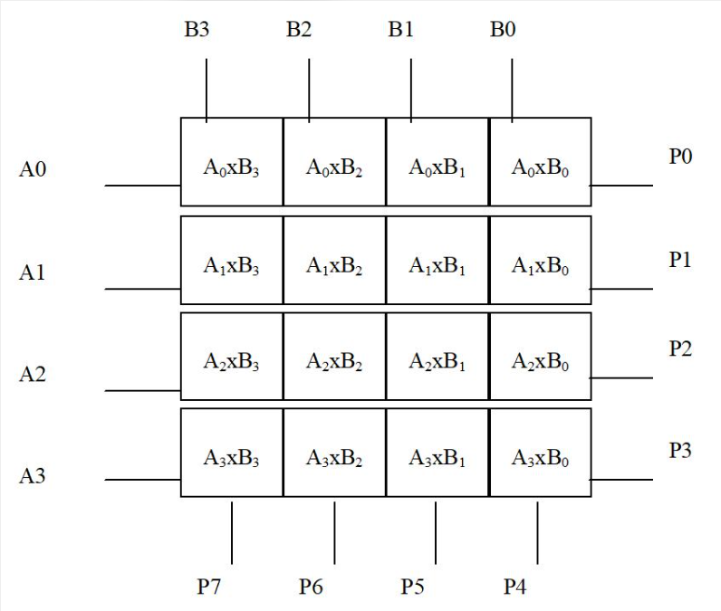

**Input Representation:**

- Multiplicand: A = (A3, A2, A1, A0)
- Multiplier: B = (B3, B2, B1, B0)

**Boolean Expression:**

`PP(i,j) = Ai AND Bj`

**Partial Product Matrix:**

| Weight | Partial Products |
|:---:|:---|
| 2^0 | A0B0 |
| 2^1 | A1B0, A0B1 |
| 2^2 | A2B0, A1B1, A0B2 |
| 2^3 | A3B0, A2B1, A1B2, A0B3 |
| 2^4 | A3B1, A2B2, A1B3 |
| 2^5 | A3B2, A2B3 |
| 2^6 | A3B3 |

**Key Features:**
- Generates 16 individual partial products.
- Uses AND-based logic operations.
- Organizes products according to binary positional weights.
- Establishes the foundation for parallel addition.

**Partial Product Generation Diagram**

**Partial Product Matrix:**

The following matrix illustrates the generation and positional alignment of 16 partial products for two 4-bit unsigned binary operands.

| Partial Products | P7 | P6 | P5 | P4 | P3 | P2 | P1 | P0 |
|:---|:---:|:---:|:---:|:---:|:---:|:---:|:---:|:---:|
| B0 × A | 0 | 0 | 0 | 0 | A3B0 | A2B0 | A1B0 | A0B0 |
| B1 × A | 0 | 0 | 0 | A3B1 | A2B1 | A1B1 | A0B1 | 0 |
| B2 × A | 0 | 0 | A3B2 | A2B2 | A1B2 | A0B2 | 0 | 0 |
| B3 × A | 0 | A3B3 | A2B3 | A1B3 | A0B3 | 0 | 0 | 0 |

### 5.2 Adder Array Configuration

The Adder Array Configuration is the core arithmetic processing stage of the BraunX4 multiplier. The generated partial products are combined using Half Adders and Full Adders to produce intermediate Sum and Carry outputs.

The Half Adders process two binary inputs, while Full Adders process three inputs, including an incoming carry. The resulting carry signals propagate towards higher-order bit positions, enabling systematic accumulation of the partial products.

**Arithmetic Components:**

- Half Adder (HA): Generates Sum and Carry from two inputs.
- Full Adder (FA): Generates Sum and Carry-out from three inputs.

**Key Features:**
- Structured arrangement of arithmetic units.
- Systematic partial product accumulation.
- Intermediate Sum and Carry generation.
- Carry propagation across successive bit positions.
- Combinational implementation without a clock signal.

**Adder Array Block Diagram**

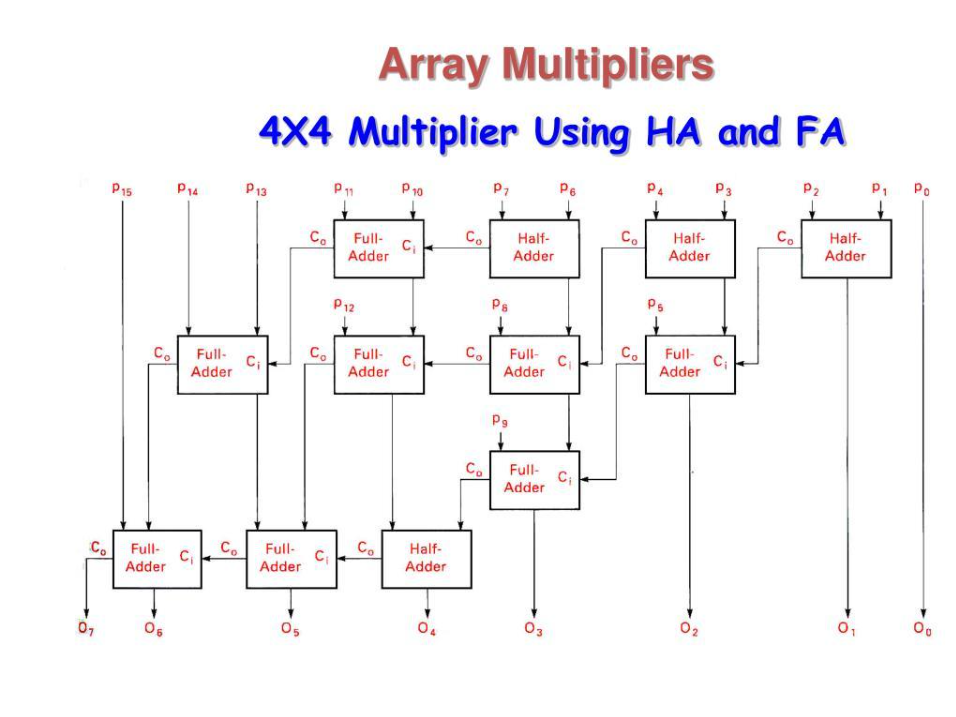

### 5.3 4-Bit Binary Multiplication

The final stage of the BraunX4 multiplier combines the generated and accumulated partial products to obtain the final 8-bit binary multiplication result.

The architecture accepts two unsigned 4-bit binary operands and generates an 8-bit product, supporting multiplication results ranging from 0 to 225.

**Input and Output Specifications:**

| Parameter | Specification |
|:---|:---|
| Multiplicand | 4-bit unsigned input |
| Multiplier | 4-bit unsigned input |
| Partial Products | 16 |
| Output Product | 8-bit binary |
| Multiplication Type | Unsigned binary multiplication |
| Architecture | Braun Array Multiplier |

**Mathematical Representation:**

`P = A × B`

`P = P7 P6 P5 P4 P3 P2 P1 P0`

**Functional Verification Example:**

| Parameter | Binary | Decimal |
|:---|:---:|:---:|
| Input A | 1010 | 10 |
| Input B | 0011 | 3 |
| Output P | 00011110 | 30 

Therefore:

`1010 × 0011 = 00011110`

`10 × 3 = 30`

**Overall BraunX4 Multiplier Schematic – Cadence Virtuoso**

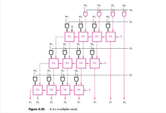

---

---

## 6. Circuit Implementation & Schematic Design

The BraunX4 multiplier is implemented using transistor-level CMOS circuit design in Cadence Virtuoso. The implementation integrates fundamental logic gates, Half Adders and Full Adders to construct a complete 4-bit unsigned Braun array multiplier. Each functional block is designed and interconnected to achieve accurate partial product generation and arithmetic computation.

The schematic-level implementation focuses on modular circuit design, transistor connectivity, logical correctness and signal propagation across different arithmetic stages.

### 6.1 Fundamental Logic Gate Implementation

The basic CMOS logic gates are implemented using complementary NMOS and PMOS transistor networks. These gates establish the foundation for the multiplier's combinational logic operations.

**Implemented Logic Gates:**

- NOT Gate (Inverter)
- NAND Gate
- OR Gate
- XOR Gate

**Logic Gate Schematics – Cadence Virtuoso**

### 6.2 Arithmetic Circuit Implementation

The Half Adder and Full Adder circuits are implemented using the designed CMOS logic gates. These arithmetic blocks perform binary addition and generate the intermediate Sum and Carry signals required for partial product accumulation.

**Half Adder Schematic**

**Full Adder Schematic**

### 6.3 Complete BraunX4 Multiplier Implementation

The individual logic and arithmetic blocks are integrated to construct the complete 4-bit Braun array multiplier. The final circuit accepts two 4-bit operands and produces an 8-bit binary multiplication result.

**Complete 4-Bit BraunX4 Multiplier Schematic**

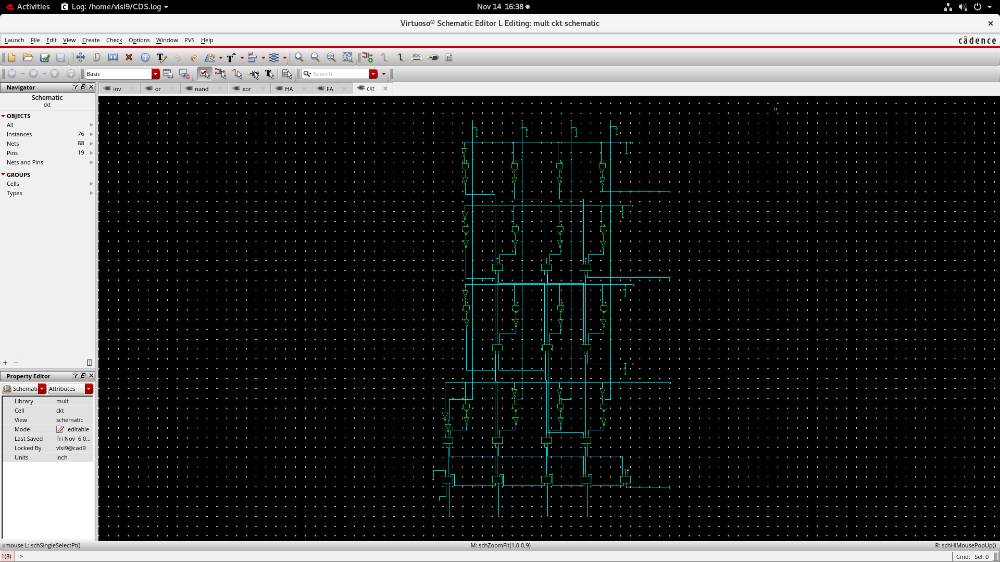

---

---

## 7. Simulation Results & Waveform Analysis

Simulation is performed to evaluate the functional correctness and signal behaviour of the designed CMOS circuits. The input combinations are applied and the corresponding output responses are observed through simulation waveforms.

The simulation results help validate the arithmetic operations, output transitions and overall functional reliability of the BraunX4 multiplier architecture.

### 7.1 Half Adder Simulation

The Half Adder circuit is simulated by applying different combinations of binary inputs A and B. The resulting Sum and Carry waveforms are observed and verified against the theoretical truth table.

**Expected Outputs:**
- Sum = A XOR B
- Carry = A AND B

### 7.2 Full Adder Simulation

The Full Adder is simulated using three input signals: A, B and Cin. The corresponding Sum and Carry-out waveforms are analyzed to verify correct binary addition across all eight possible input combinations.

**Expected Outputs:**
- Sum = A XOR B XOR Cin
- Cout = AB + ACin + BCin

### 7.3 BraunX4 Multiplier Simulation

The complete BraunX4 multiplier is simulated by applying different combinations of 4-bit unsigned input operands. The resulting 8-bit output product is observed and analyzed to verify accurate binary multiplication.

The simulation evaluates the interaction between partial product generation and the adder array, ensuring that the final output corresponds to the mathematical product of the applied operands.

**Input and Output Signals:**
- Input A: 4-bit multiplicand.
- Input B: 4-bit multiplier.
- Output P: 8-bit product.

**BraunX4 Multiplier Simulation Waveform**

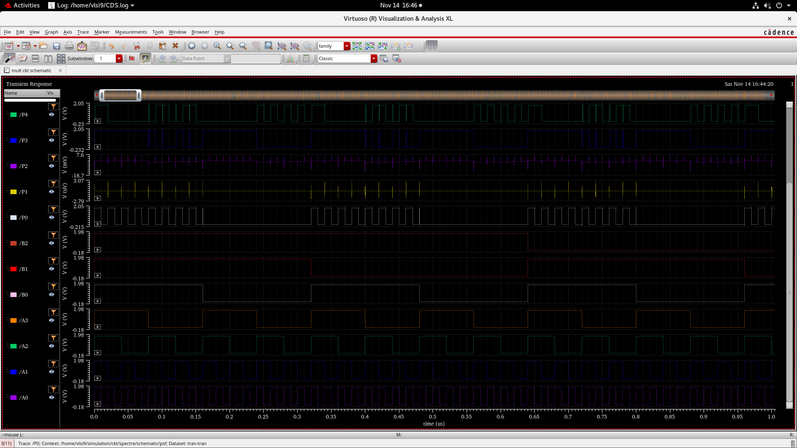
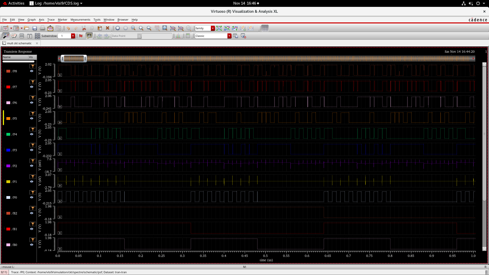
### 7.4 Functional Verification

Functional verification confirms that the implemented BraunX4 multiplier produces the correct 8-bit output for different combinations of input operands.

The simulated outputs are compared against the expected mathematical multiplication results to establish the functional correctness of the design.

**Sample Verification Cases:**

| Input A | Input B | Expected Product |
|:---:|:---:|:---:|
| 0010 | 0011 | 00000110 |
| 0101 | 0010 | 00001010 |
| 0110 | 0011 | 00010010 |
| 1000 | 0100 | 00100000 |
| 1010 | 0011 | 00011110 |
| 1111 | 1111 | 11100001 |

**Functional Verification Waveform**

---

---

## 9. Applications

The BraunX4 multiplier demonstrates the fundamental principles of digital arithmetic computation and combinational circuit design. Its architecture serves as a foundational building block for understanding multiplication hardware used in modern digital systems.

### 9.1 Digital Signal Processing (DSP)

Multiplication is a fundamental operation in DSP applications, including digital filtering, signal transformation and arithmetic processing.

### 9.2 Arithmetic Logic Units (ALUs)

Multiplier architectures are essential components of processor arithmetic units, supporting mathematical operations in digital computing systems.

---

## 10. Future Enhancements

The BraunX4 multiplier provides a foundation for exploring advanced arithmetic architectures and optimization techniques. Several improvements can be considered to enhance its computational efficiency, scalability and physical implementation.

### Proposed Enhancements

1. **Higher-Bit Multiplier Design:** Extend the architecture to 8-bit, 16-bit and 32-bit multiplication.
2. **Power Optimization:** Explore low-power CMOS techniques to reduce dynamic and leakage power.
3. **Delay Optimization:** Investigate faster adder architectures to minimize critical-path propagation delay.
4. **Area Optimization:** Reduce transistor count through optimized logic structures and circuit sharing.
5. **Physical Design Implementation:** Extend the design towards layout optimization, parasitic extraction and post-layout verification.
6. **Advanced Multiplier Architectures:** Explore Wallace Tree and Booth multiplier architectures for performance comparison.
---
## 11. Conclusion

The BraunX4 project successfully demonstrates the architectural principles of a 4-bit unsigned Braun Array Multiplier using CMOS-based combinational logic design. By integrating partial product generation, Half Adders and Full Adders, the design establishes a structured approach to binary multiplication and produces an 8-bit output.

The implementation provides valuable practical experience in digital logic design, transistor-level circuit development, arithmetic architecture and simulation-based functional verification using Cadence Virtuoso.

Overall, BraunX4 highlights the significance of modular circuit design and fundamental VLSI principles in developing efficient digital arithmetic systems. It also establishes a foundation for future exploration of high-performance, low-power and scalable multiplier architectures.

